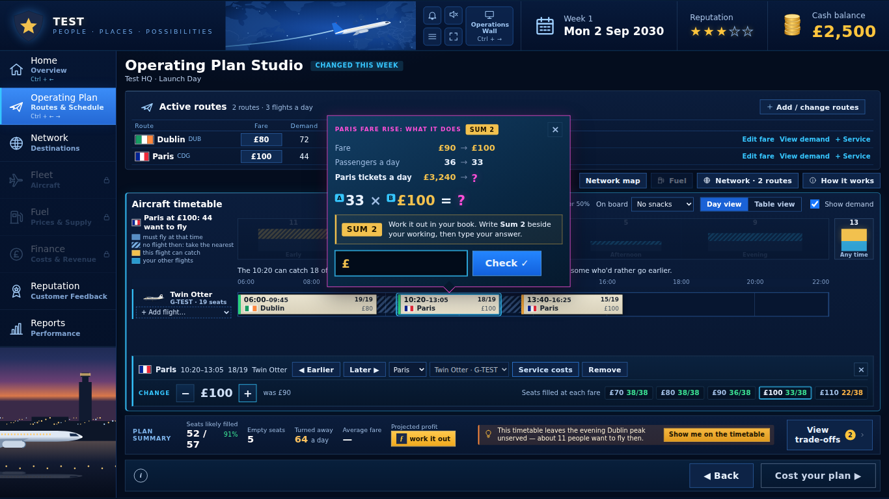
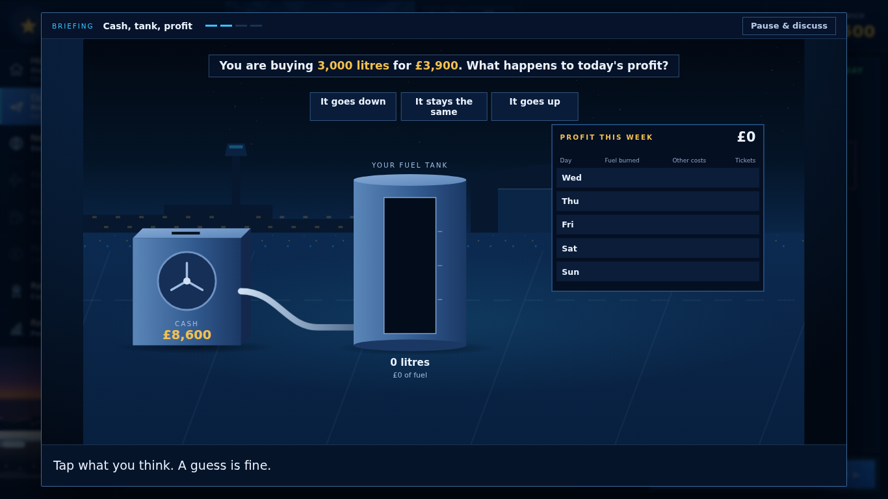
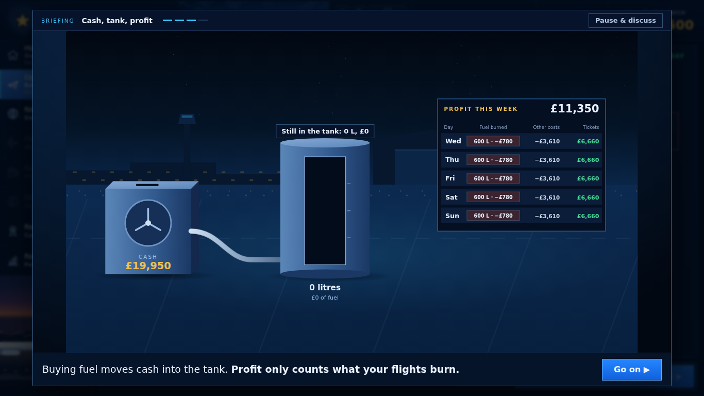
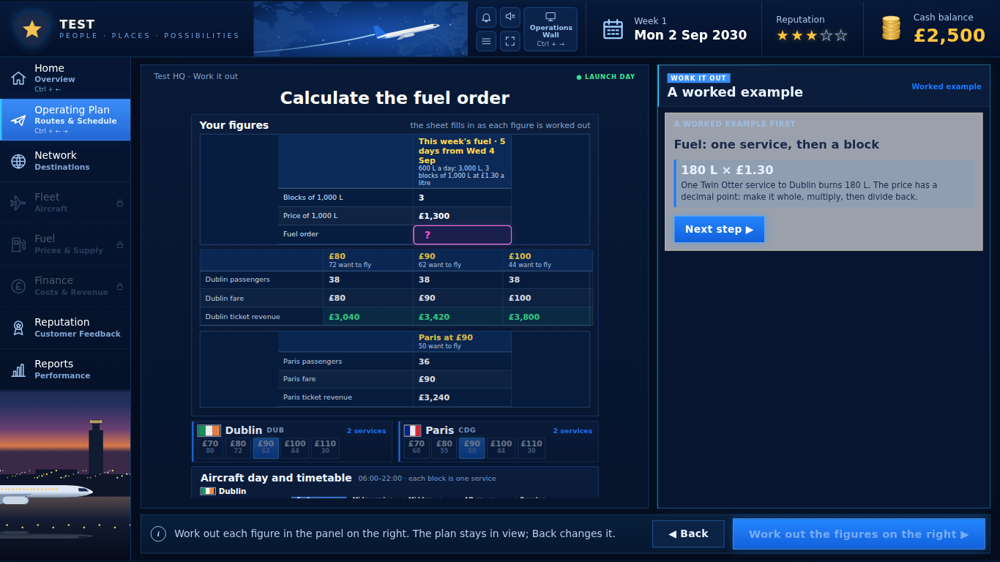
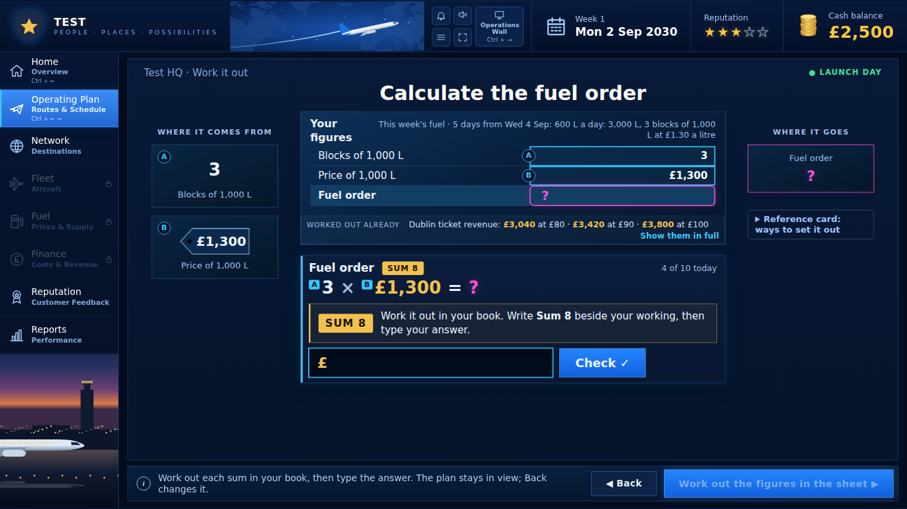
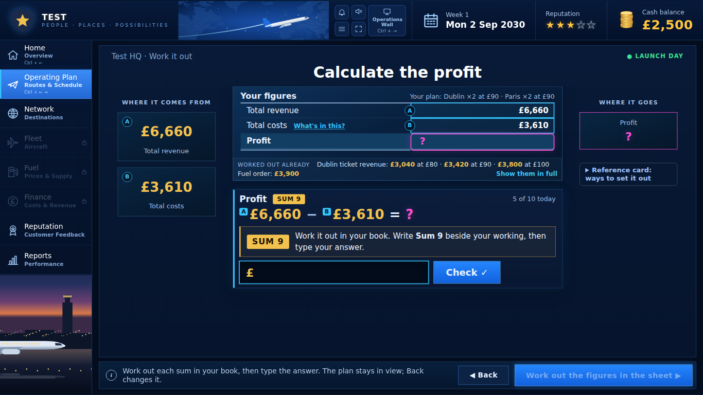
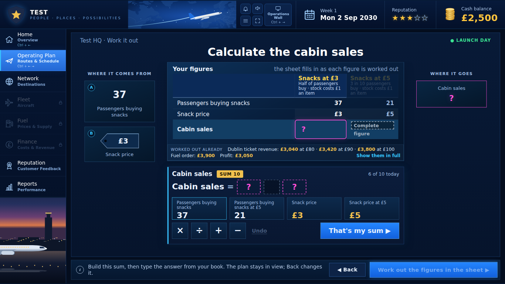

# Play-test 19 Oct 17:09: report for Claude Design

*Claude Code, 19 October 2026. A copy of the Claude Doc https://claude.ai/code/artifact/d95b7235-920c-4362-ab44-d3d5f0af182b. The screenshots are in `docs/screenshots/playnotes-19oct/`. The transcript is `docs/screenshots/playnotes-19oct/transcript.txt`, with each line placed on its screen.*

## Summary

Bertie's main ask is to turn Launch Day's sums into one fuller spreadsheet. Each part of it takes a turn as the focal point, instead of the game moving through a separate screen for each sum. Pupils build a sum by clicking the sheet's cells, not separate tiles: "a link to ICT skills".

The 9½-minute run covered Launch Day only, from the Studio to the end of the sums. Five design points came out of it:

- **Studio worth callout.** Bertie likes the format of the callouts. But this one came too soon: they hadn't yet confirmed the flight. It also disappeared for good when they clicked away, and "Paris tickets a day = ?" didn't read as a question.
- **Cash, tank, profit briefing.** It arrives without an introduction to fuel. It opens with a guess the pupil doesn't need to make. Its rule line ("Buying fuel moves cash into the tank") confuses.
- **Fuel worked example.** This screen is the last Launch Day screen still in the old two-column layout. It looks squished, and Bertie wants it gone: the class learns this from the teacher, in their books.
- **One sheet.** Columns should be the route and fare options, side by side; rows should be passengers, fare and ticket revenue. Costs (fuel) go underneath, like a balance sheet, then profit.
- **The profit sum.** It should say "Total profit = revenue − costs. Work it out in your book." without writing the numbers into the sum.

Six of these asks run against DESIGN.md as it stands (section 6). Everything here is year one only: Launch Day, chapter 1.

## The run

Bertie played Launch Day (Week 1, Mon 2 Sep 2030) on the build of 18 Oct with Batch 2 in it. The run started at 17:09 and lasted 9 min 36 s. It shows six screens; Bertie pressed Mark six times.

| Time | Screen (from the log) | What Bertie talked about |
| --- | --- | --- |
| 0:00 | Studio: route editor (save 1) | The worth callout: it vanishes on a click away, and its question is unclear. Mark at 0:16 |
| 2:12 | Studio: flight selected | The callout comes before they had confirmed the flight; they like the callouts' format |
| 2:50 | Sums (save 2) | Dublin ticket revenue at three fares; no remarks on it |
| 3:34 | Briefing: Cash, tank, profit | Fuel isn't introduced; the opening question; the rule line. Mark at 3:50 |
| 5:45 | Sums tutorial (fuel worked example) | Squished; one sheet with options as columns; drop the worked example. Mark at 5:51 |
| 6:56 | Sums: profit, then cabin sales | Focal points on one sheet; don't write the sum out; build by clicking cells. Marks at 7:00, 7:24 and 8:15 |

**How the screens below were made.** I loaded the two save codes from the log into the same build at 1366 × 768. From the second save, I answered each sum with the teacher's test kit, which reaches the same screens in the same order Bertie saw them. I made the callout by raising the Paris fare from £90 to £100 on save 1, which gives the callout's "Paris tickets a day" row.

**Gaps in the recording.** The transcript picks up no speech from 0:00 to 0:12 or from 2:46 to 3:39. The quotes below are Bertie's words, lightly tidied.

## Screen by screen

Each screen below gives Bertie's words, then what the screen does now, then what that means for the design.

### 1. Studio: the Worth Sum Callout (0:12–2:46)

> "I just clicked away from the container and the question disappears. So if we do want the child to answer that question, we need to sort that out. … I like the callout, but I find it difficult to understand. Paris tickets a day equals, I'm not sure what I'm supposed to do. I just don't know what the question is. … I haven't even confirmed I want to do this flight. So I think it's come too soon. … They should be allowed to play around with just setting up flights to try and fill them. And then if they want to do said flights, then they click confirm, and then maybe the costs come up. I like the format of the callouts."

**What it does now:**

- Any change to a flight opens the callout at once: a fare step, a new time, or an added flight.
- It closes on a click on the timetable, on another flight, on Table view, or on Esc. That follows the WorthSumCallout spec ("Closes on Done, on choosing another object, or on clicking elsewhere").
- Once closed, it never comes back, not even when the same flight is selected again. So the sum is lost.
- The callout has a heading ("PARIS FARE RISE: WHAT IT DOES") but no question in words. Its only line with a "?" is "Paris tickets a day £3,240 → ?", above "33 × £100 = ?".

**For the design:**

- Keep the callout's look.
- Change when it appears: the pupil is free to try flights and fares, then confirms the change, and only then is asked for the sum.
- A closed callout needs a way back, such as a marker on the flight or a line in the plan summary, or it should not close until it is answered.
- Give it a question in words, for example "How much will Paris tickets bring in a day at £100?".

### 2. Briefing: Cash, tank, profit (3:34–5:45)

> "This screen has come up quickly. And I don't feel like we've introduced fuel very well here. It should probably say something like: to run your plane, you will need to have fuel. Fuel prices fluctuate, they go up and down, and sometimes you won't be able to avoid this. But sometimes you might want to invest in fuel when you think it's at a good price. And I don't think they need a question at the start of this, like does it go down, does it stay the same, does it go up? It should just show how the cost price of fuel is accounted for."

> "'Buying fuel moves cash into the tank' is a bit confusing. 'Profit only counts what your flights burn': it should be more like, under that spreadsheet, the cost of the fuel does not come off all at once, it is allocated per day. Something like that, in child-friendly language. So on day one, if you make 5,000, it's not going to charge you all 13 grand on that day, because you'd make a loss."

**What it does now:** the briefing opens straight onto "You are buying 3,000 litres for £3,900. What happens to today's profit?" with three answer buttons. Next waits for an answer. Then come Buy fuel, the week flying day by day (600 L · −£780 a day), the rule line, and "Next: your fuel order".

**For the design:**

- Add an opening beat in plain words: a plane needs fuel; its price goes up and down; sometimes you can buy when the price is good.
- Drop the opening guess.
- Rewrite the rule line under the profit table as "The fuel's cost doesn't come off all at once. Each day pays for the fuel it burns", pointing at the −£780 on each row.

### 3. Fuel order: the worked example (5:45–6:56)

> "Calculate the fuel order. This looks a little bit squished; we've got some white space around it. … Rather than split the Dublin and Paris parts of the spreadsheet, maybe it should say Paris at £90, Dublin at £90, Dublin at £100 as column headings, rather than the row headings. And then the row headings can just be number of passengers, fare, ticket revenue, so that we can compare side by side. I think that will look a lot neater. And then the fuel can go underneath that, as it would as a cost, like a proper balance sheet. I don't think we need to worry about the worked example. We're trusting that I've taught them this. So they're going to do it in their books. So Calculate the fuel order should be coming from the fuel desk, which is actually locked at the moment."

**What it does now:**

- This is the one Launch Day sums screen still in the pre-Batch-1 layout: a sheet on the left, a grey worked-example panel on the right, and the route strips and timetable underneath.
- The sheet has three separate blocks: the fuel (one column), Dublin (three fare columns, rows named "Dublin passengers" and so on), and Paris (one column).
- The worked example runs four steps before the pupil's own sum: 180 L × £1.30, make it whole, multiply, divide back.
- The pupil's sum then opens in the new layout (below). The Fuel desk in the side menu is still locked on Launch Day.

**For the design:**

- No forced worked example on Launch Day. DESIGN.md already wants it behind "Show me how".
- One sheet, laid out as in section 4 below.
- Ask the fuel order on the Fuel desk, unlocked for Launch Day, not on the sums page.

### 4. Profit and cabin sales (6:56–9:36)

> "Calculate the profit. I think really, to educate them, I would like it to be more of a spreadsheet, where different parts become focal points using different mechanisms, like highlighting those rows. I don't necessarily write out the sum for them, even at this stage. Just say total profit equals revenue take away costs. Work it out in your book."

> "Maybe on the snacks page. Again, I think this should be part of a main spreadsheet, but it sort of zooms in on it, emphasises it with a different border colour, darkens the other bit, rather than cycling through screens. We don't need to build the sum, I don't think. And if we do build the sum, I think they should be clicking on the spreadsheet as the buttons rather than having different buttons. So maybe actually we do build the sum, but by clicking on the spreadsheet; then we don't have to have this extra box of cabin sales with large text. … So a lot of the feedback comes down to having a more full spreadsheet that, at various points, different parts of it become the focal point. Maybe with callouts to introduce things, and to build sums they should be clicking on the cells. And this is good, sort of a link to ICT skills."

**What it does now:**

- Each sum gets its own screen, and each screen shows a different small sheet: the Dublin fares; the fuel order; Total revenue, Total costs and Profit; the snacks at £3 and £5.
- Everything already worked out is folded into a "Worked out already" line.
- The profit panel writes the sum out in full: £6,660 − £3,610 = ?.
- Cabin sales adds a Build step: four tiles and four operation buttons under a large "Cabin sales = ? ?" line.

**For the design:**

- One Launch Day sheet that stays on screen for all ten sums.
- The part being worked out is lit and outlined in its own border colour; the rest recedes.
- A sum is built by clicking the sheet's cells, the way the Sunday review's formula bar already works, so the tile box goes.
- The panel states the rule in words ("Total profit = revenue − costs"), not the figures.
- Short callouts on the sheet introduce new rows.

## Design asks, in priority order

The first ask is the Launch Day sheet. Most of Bertie's remarks lead back to it, and asks 2 and 3 depend on it.

| # | Ask | Screens | Runs against DESIGN.md? |
| --- | --- | --- | --- |
| 1 | **One Launch Day sheet.** It stays on screen for all ten sums. Each sum lights its own part (border colour, the rest receding) instead of opening a new screen with a new small sheet | Sums: ticket revenue, fuel order, profit, cabin sales, snack price | Partly: the Work it out page and Local spotlight (section 6, item 6) |
| 2 | **Build sums by clicking the sheet's cells.** The same idea as the Sunday review's formula bar. The panel states the rule in words ("Total profit = revenue − costs. Work it out in your book."), not the figures. No separate tile box | Profit, cabin sales, every Launch Day Build | Yes: Calculation Builder (items 4 and 5) |
| 3 | **No forced worked example; the fuel order on the Fuel desk.** Remove the four-step fuel tutorial. Ask the fuel order on the Fuel desk, unlocked for Launch Day | Sums tutorial, Fuel desk | No: DESIGN.md already wants examples behind "Show me how" |
| 4 | **Worth Sum Callout after Confirm.** The pupil tries flights freely, then confirms. The callout appears after that, asks its question in words, and can't be lost by a click away | Studio | Yes: WorthSumCallout "Closes" (item 1) |
| 5 | **Cash, tank, profit: introduce fuel first.** An opening beat on what fuel is and why its price matters; no opening guess; a per-day rule line under the profit table | Briefing | Yes: the Notice step and the FuelTank wording (items 2 and 3) |

### The sheet Bertie described (ask 1)

Here are the Launch Day figures from this run, laid out as Bertie said. The options are columns. Passengers, fare and ticket revenue are rows. Costs sit underneath "like a proper balance sheet", then profit.

| Launch Day | Dublin at £80 | Dublin at £90 | Dublin at £100 | Paris at £90 |
| --- | --- | --- | --- | --- |
| Passengers | 38 | 38 | 38 | 36 |
| Fare | £80 | £90 | £100 | £90 |
| Ticket revenue | £3,040 | £3,420 | £3,800 | £3,240 |
| **Your plan** | | **chosen** | | **flying** |
| Total revenue | £6,660 | | | |
| Costs (what's in this) | £3,610 | | | |
| Fuel | ? see section 6, item 7 | | | |
| **Profit** | **£3,050** | | | |
| Cabin sales: snacks at £3 / £5 | 37 × £3 = £111 | 21 × £5 = £105 | | |

The sheet's states, in sum order:

1. The ticket revenue row is lit, one fare column at a time.
2. The fare chosen lifts out as "Your plan".
3. Total revenue, costs and profit light in turn.
4. The cabin sales row lights last.

Each step dims the rest of the sheet and outlines its part in its own border colour. To build a sum, the pupil clicks the cells it uses (for profit: Total revenue, then −, then Costs).

### What to send back

- Mock-ups at 1366 × 768 and 1920 × 1080 of: the sheet at four of its states (ticket revenue, profit, cabin sales being built by clicking cells, and done); the Studio with a Confirm step and the callout after it; and the briefing's new first beat and rule line.
- Updated DESIGN.md text for each conflict in section 6 that Bertie accepts.
- Year one only, like Batches 1 and 2.

## Not design: for Claude Code and Fable

These came out of the run but are game behaviour or data, not looks. Claude Code will pick them up once the designs land.

| Item | Who | Note |
| --- | --- | --- |
| A Confirm step in the Studio, so worth sums wait until a change is confirmed | Claude Code | Today every fare step, time change or added flight sets a new callout at once |
| The fuel order moved from the sums to the Fuel desk on Launch Day | Claude Code | The desk is locked until week 2 now. Its first-visit tour and Briefing 13 will need their order checked |
| The briefing's words: the new first beat and the per-day rule line | Fable, then Claude Code | The text sits in the briefing page, not the workbook |
| Launch Day's own fuel is free, so Monday's profit (£3,050) has no fuel in it, while the briefing's Wed–Sun days take −£780 each | Fable | Worth a line on the sheet, or pupils will ask why Monday's profit is higher |
| No worked example on Launch Day | Bertie (teaching) | The class learns the method from the teacher and works in their books |

## Questions for Bertie: where this runs against DESIGN.md

Six of Bertie's asks change rules that DESIGN.md (18 Oct) sets out, and one figure is an open question. Claude Design should treat each of the six as a change to the system, not a one-off, once Bertie agrees.

| # | DESIGN.md says | Bertie said on 19 Oct | Question |
| --- | --- | --- | --- |
| 1 | WorthSumCallout: "Closes on Done, on choosing another object, or on clicking elsewhere" | Clicking away loses the question; the callout comes too soon | Should it stay open until it is answered, or close and leave a way back? Does it wait for a Confirm? |
| 2 | OperationsBriefing: Show → Notice ("ask the pupil to pick something"; Next waits for it) → Reveal → Use | "I don't think they need a question at the start" | Drop the Notice step from Cash, tank, profit only, or make it optional in every briefing? (This briefing asks its question before showing anything, which already breaks the Show-first order.) |
| 3 | FuelTank: "buying it moves cash into the tank", and the panel says profit is unchanged | "'Buying fuel moves cash into the tank' is a bit confusing" | Should the FuelTank wording change everywhere, for example to "Fuel you buy is paid for as you fly it, a day at a time"? |
| 4 | Calculation Builder: "The Week 1 flow for every sum": build from four figure tiles and an operation | "We don't need to build the sum … if we do, they should be clicking on the spreadsheet" | Replace the tiles with cell-clicking in year one (as the Sunday review does)? Do some sums skip the build? |
| 5 | Calculation Builder step 2: "The built sum shows large", with the A and B tags | "I don't necessarily write out the sum for them … just say total profit equals revenue take away costs" | Should step 2 show the rule in words and keep the figures only on the sheet? |
| 6 | Local spotlight: "Never darken the whole screen". Work it out page: one sheet object, 640px wide | "Darkens the other bit … rather than cycling through screens"; options as columns side by side | Is dimming the rest of the sheet (not the screen) allowed? Can the sheet grow past 640px for four or more option columns? |
| 7 | Not covered | Fuel "underneath, as a cost" | On a day's sheet, is the fuel row the day's fuel burned (−£780, none on Launch Day) or the week's order (£3,900)? Bertie's per-day remark points to fuel burned |

DESIGN.md has not been edited; any change comes back in Claude Design's handover.
