# Play-test 21 Oct 18:43: report for Claude Design

*Claude Code, 21 October 2026. A copy of the Claude Doc https://claude.ai/artifact/MJDEKPv1qPWTxhB91JQMAx. The screenshots are in `docs/screenshots/playnotes-21oct/`. The transcript is `docs/screenshots/playnotes-21oct/transcript.txt`, with each line placed on its screen.*

## Summary

Bertie played from the week 2 Fuel desk (Mon 9 Sep 2030) to week 4's New today (Mon 23 Sep), 17 minutes with 7 marks. Bertie likes the spreadsheet style, and most asks are about making each new idea clearer the first time a pupil meets it.

- **Fuel desk tour:** dim the rest of the screen while the tour runs, and don't leave the cursor blinking in the order cell before the tour reaches it. With the tour boxes up, the purchase order needed scrolling.
- **The tank:** pupils need a better introduction to the tank's size.
- **Star rating:** the "What it is worth" panel is too much; make it visual or drop it.
- **How long will it take?:** the briefing is in a confusing order. Start with why flight times matter, and walk through the sum.
- **Studio, week 3:** Sat–Sun is new, so make it the focal point with a callout.
- **Changes sheet:** explain the +10, −10 and −£10 Difference column with a callout the first time.
- **Operations Wall graph:** its purpose and axes are unclear, and the play-notes recorder covers its key.
- **Sunday review:** teach =SUM over a range with a callout. Stop asking for the week's profit and the average a day to be worked out by hand.
- **New routes:** Amsterdam, Frankfurt, Geneva and Barcelona opened in week 3 without Bertie noticing, and the week 3 review then named them.

Two asks run against DESIGN.md as it stands, and one adds a rule (see that section). Everything here is year one only. No game changes have been made yet.

## Bertie's answers to the 20 Oct questions

All three are decided, and they go into the next build round with the changes below.

| Question | Answer | What it means |
| --- | --- | --- |
| Make Launch Day's first ticket sum a Build? | Yes | The pupil builds the first ticket sum by clicking cells (SheetSums `launch.tickets`, how = build); the other columns stay Calculate. |
| A new curveball for 24 September? | No | The day the snack supplier used stays without a curveball. |
| Keep Captain's challenge 2, "Win the catering contract"? | Yes | It stays as it is (21 April 2031). |

## The run

The run started at 18:43 and lasted 16 min 59 s, on airline TEST2 from week 2 to the start of week 4. Bertie pressed Mark seven times.

| Time | Screen (from the log) | What Bertie talked about |
| --- | --- | --- |
| 0:00 | Fuel desk, Mon 9 Sep (week 2) | The tour: scrolling, the blinking cursor, dimming the rest. Likes the spreadsheet style. Mark at 0:17 |
| 2:50 | Fuel desk | Introduce the tank's size better |
| 3:26–4:09 | Ready, Operations Wall, Results | No remarks |
| 4:09 | Event card: A school trip (Tue 10 Sep) | Did week 2 give a chance to change the flights? |
| 4:41–6:04 | The board, Crew sickness, Sunday review | No remarks |
| 6:04 | Briefing: Weekdays and weekends | Read its first line aloud; no remarks |
| 6:59 | Star rating (Mon 16 Sep, week 3) | "What it is worth" is hard to follow |
| 7:42 | Briefing: How long will it take? | Confusing ruler, wrong order, no sum shown. Mark at 8:02 |
| 8:59 | Flight times | Two rows already answered looked confusing at first. Mark at 9:39 |
| 10:09 | Plan opener, then Studio | Make Sat–Sun the focal point, with a callout. Mark at 10:31 |
| 11:01 | Sums: Is the change worth it? | Explain +10 / −10 / −£10 the first time. Mark at 11:27 |
| 11:46–12:19 | Fuel desk, Ready | No remarks |
| 12:19 | Operations Wall: Day complete | The profit graph: its key is covered, and its purpose and axes are unclear. Mark at 12:26 |
| 13:03–13:46 | Results, the board, Ground staff strike | No remarks |
| 13:46 | Sunday review, week 3 | Teach =SUM over a range; drop the profit and average sums. Mark at 13:51 |
| 15:49 | Home, Mon 23 Sep (week 4) | When did the new routes open? |
| 16:16 | New today: Madrid | The review named routes he hadn't been offered |

**How the screens below were made.** Each screen comes from the save code the log keeps for it, loaded into the build of 20 Oct at 1366 × 768. The Studio, the plan opener and the briefing's beats were reached from the nearest save by playing on with the teacher's test kit.

**Gaps in the recording.** No speech was picked up before 0:13, from 2:20 to 2:49, from 3:08 to 4:09, or from 13:01 to 13:56. The quotes below are Bertie's words, lightly tidied; where the transcript is unsure, it says so.

## Screen by screen

Each screen below gives Bertie's words, then what the screen does now, then what that means for the design.

### 1. Fuel desk: the tour (0:13–2:15)

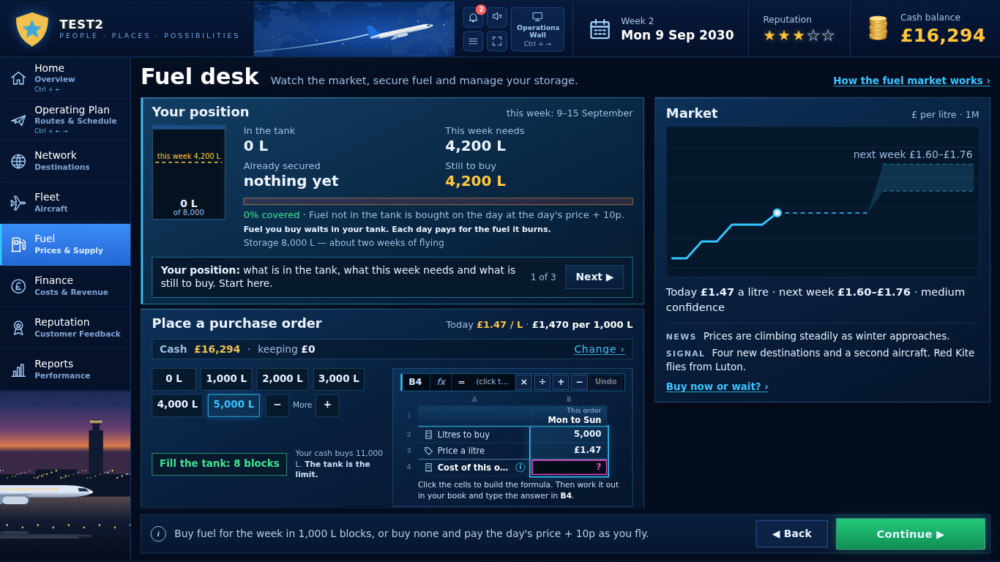

> "On this screen, Place a purchase order, I have to scroll to read the full 'Click the cells to build the formula, then work it out in your book and type the answer in'. … We need to make sure that before Place a purchase order, the cursor is not blinking, because it feels like that's where my attention goes. And to focus attention better, the rest of the screen needs to go a bit darker than it has been. … I really like the spreadsheet style, and I backtrack about the scrolling issue, because once the tutorial boxes were over, that wasn't an issue any more."

**What it does now:**

- The tour has three steps: Your position, then Market, then Place a purchase order.
- The order sheet's answer cell (B4) waits with its magenta "?" from the start, so the eye goes there before the tour does.
- Nothing dims while the tour talks. The instruction line sits at the foot of the order panel, which a shorter window pushes out of view while a tour box is up.

**For the design:**

- While the tour runs, dim everything but the panel it is on, as the Sheet focus already does (62%).
- Hold the answer cell back until the tour reaches the order.
- Keep the spreadsheet look.

### 2. Fuel desk: the tank's size (2:49–3:08)

> "I haven't actually seen the briefing about fuel, but we should be introduced to the size of the tank better."

**What it does now:** the save marks Cash, tank, profit as opened on Mon 9 Sep, before the recording began, so it may have been skipped. The tank's size shows only as "of 8,000" under the gauge and "Storage 8,000 L — about two weeks of flying".

**For the design:** a first-time callout on the tank: 8,000 L holds about two weeks of flying, and this week needs 4,200 L. The scene-by-scene re-plan already gives Cash, tank, profit a longer middle, so the tank's size could go there too.

### 3. Event card: A school trip (4:09)

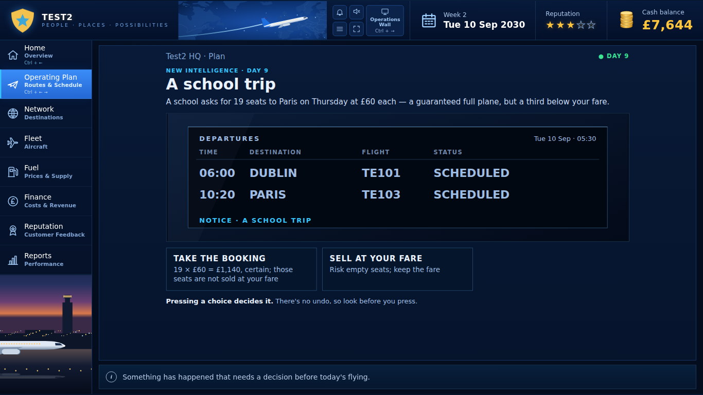

> "So on the second week, did I not get the opportunity to change my flight? Can you just look at that? I might have done, but I'm not sure."

Answered from the save in "Bertie's two questions" below.

### 4. Star rating (6:59–7:42)

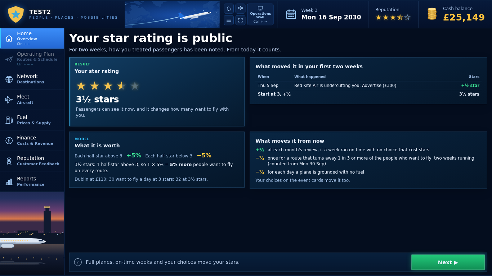

> "What is it worth, on here? Either this needs to be more visual, or we don't need so much information, because even I'm finding it difficult to understand. I don't even think 'what it is worth' is necessary."

**What it does now:** four panels: the result (3½ stars), what moved it, What it is worth (+5% demand for each half-star above 3; Dublin 30 → 32 a day) and what moves it from now.

**For the design:** drop What it is worth, or show it as a picture: Dublin's queue at 3 stars beside 3½ stars, 30 people and 32.

### 5. Briefing: How long will it take? (7:42–8:59)

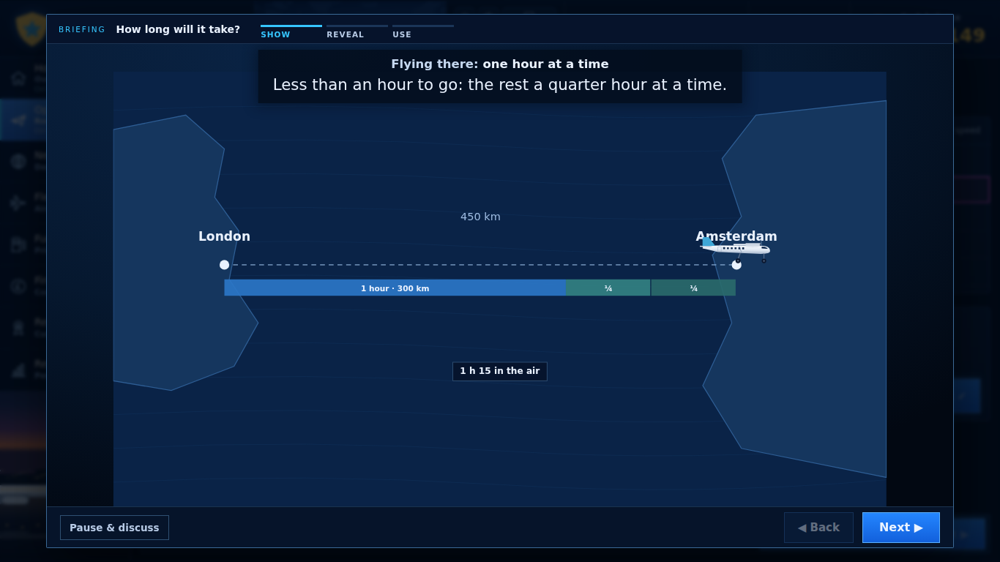

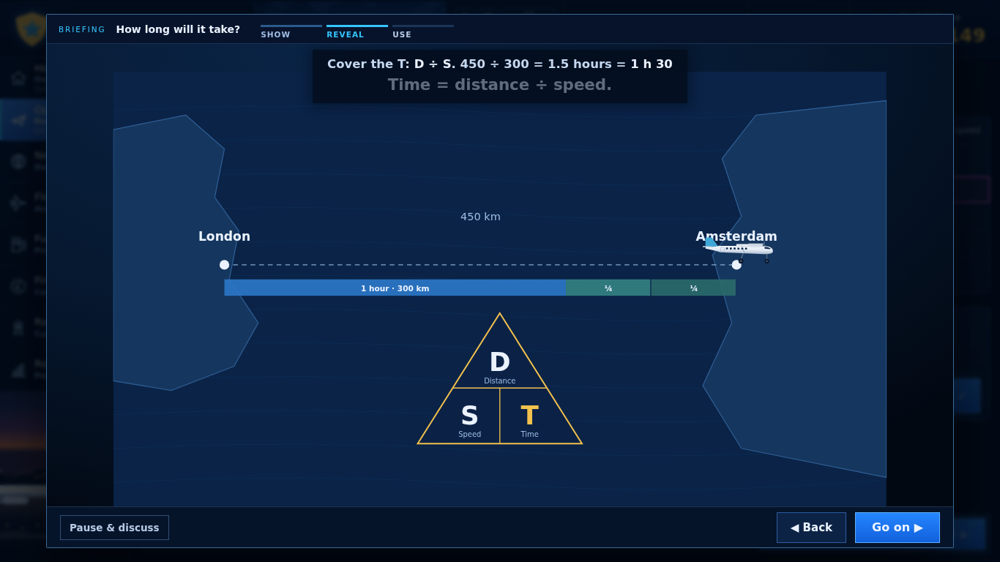

> "'Flying there one hour at a time, less than an hour to go.' I'm confused what this is talking about. … I feel like this is all in a funny order. We need to say it will be important at times to work out how long a flight is going to take, and different planes will have different speeds and will therefore take different amounts of time. The faster the plane, the more flights you can fit into a day, but it might cost more money in fuel. So these are things that you have to balance. … I don't think it really took me through how it works with the sum. The animation came right at the beginning, and then it didn't show me any calculations."

**What it does now:** three beats.

1. Show: the plane flies London to Amsterdam over a ruler, a whole hour at a time, then quarter hours.
2. Reveal: one caption line, "450 ÷ 300 = 1.5 hours = 1 h 30", and the distance–speed–time triangle.
3. Use: "Next: the flight time to Amsterdam, worked out."

**For the design:** start with why it matters (planes fly at different speeds; a faster plane fits more flights in a day but may cost more in fuel). Then work the sum on screen a step at a time: 450 km ÷ 300 km/h, the whole hours, then the part left over in minutes. The ruler comes last, as the check. The scene-by-scene doc already re-plans this briefing, so this order can go in when its decisions are ticked.

### 6. Flight times (8:59–10:09)

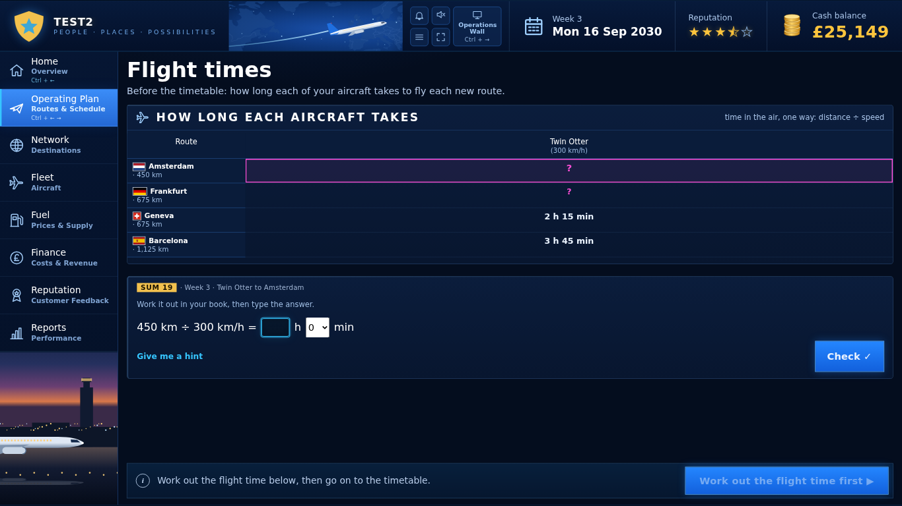

> "On here, that's confusing because it says — oh wait, no, that's the answer. Never mind."

**What it does now:** Amsterdam and Frankfurt are the pupil's two sums. Geneva (2 h 15) and Barcelona (3 h 45) are filled in by the game, in the same style as an answer.

**For the design:** mark the filled rows as the game's (the ƒ sign and muted figures, as on the sheets), or add "worked out for you" beside them.

### 7. Plan opener and Studio, week 3 (10:09–11:01)

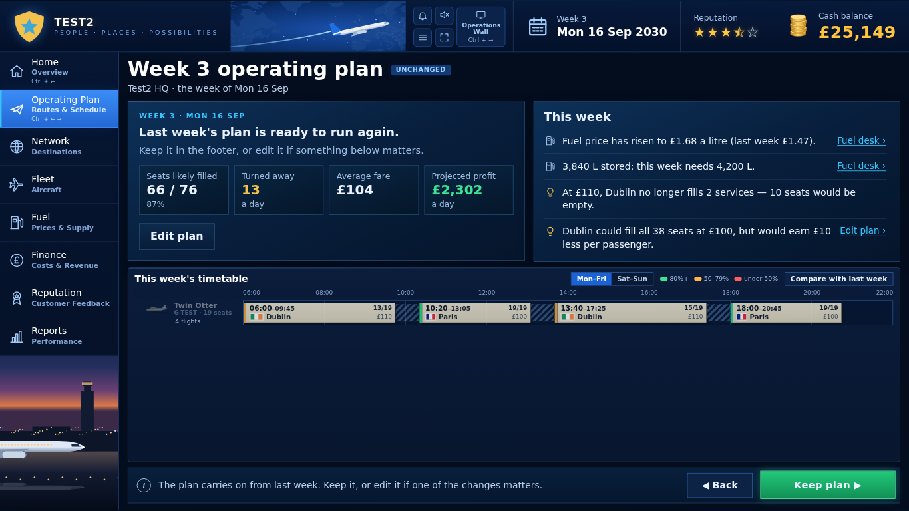

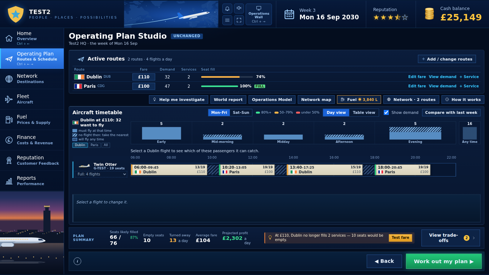

> "So on this page, I need you to highlight the Saturday and Sunday as a focal point, with a callout saying this is where you can now change the flights on a Saturday and Sunday to meet demand better. Although it kind of looks like the demand is fine."

**What it does now:** Days arrive in week 3, approved by the Weekdays and weekends briefing the Sunday before. The Mon–Fri / Sat–Sun switch sits small above the timetable in the plan opener and the Studio, and nothing points to it.

**For the design:** the first week it exists, light the Sat–Sun switch as the focal point, with a Sheet-Callout-style note: "New: plan Saturday and Sunday on their own, to meet weekend demand." It closes on Got it and doesn't come back.

### 8. Sums: Is the change worth it? (11:01–11:46)

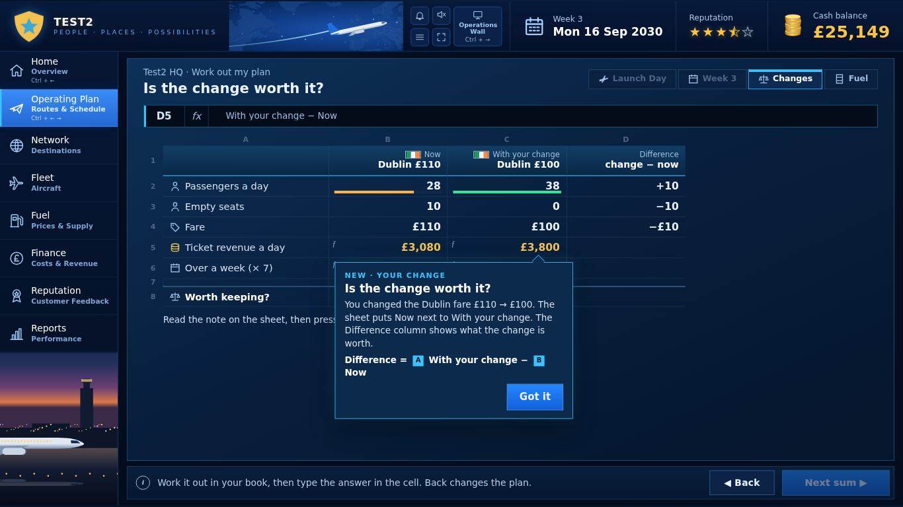

> "On this one, I like it, but just make it clear what I'm supposed to be doing on that first one. I think the plus 10, minus 10, then minus £10 confused me at first. So maybe we just need a callout there, explaining that for the first time."

**What it does now:** a NEW · YOUR CHANGE callout opens over rows 5–8. It says "Difference = With your change − Now" but not what the signs mean, and it covers the rows the sum is about.

**For the design:** point the callout at the Difference column and read one row in words: "+10 means 10 more passengers a day; −£10 means the fare is £10 lower." Place it beside the column, not over the rows, and say what to do first.

### 9. Operations Wall: the profit graph (12:19–13:01)

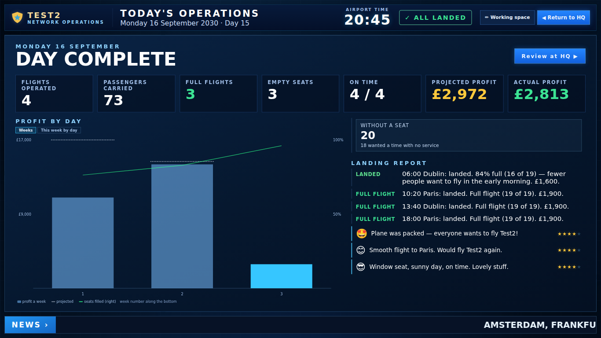

> "The recording box is slightly covering the key for this graph. But can you show me what this graph is actually for? Because I'm a little bit confused. Oh, I guess it's because it's only Monday. I don't think it's very clear at the moment, based on the graph. It's not obvious what each axis is."

**What it does now:**

- The panel is titled Profit by day but opens on its Weeks tab: one bar per week, with week 3 holding only Monday so far.
- A dotted line marks each week's projection, and a green line shows seats filled on the right-hand axis.
- The key is one small line under the chart, bottom left, where the play-notes recorder sits.

**For the design:**

- Name it after the tab that is showing ("Profit each week").
- Put axis titles in words: profit (£) on the left, seats filled (%) on the right, week along the bottom.
- Mark the current bar "so far: Monday", and move the key to the top right.

### 10. Sunday review, week 3 (13:56–15:49)

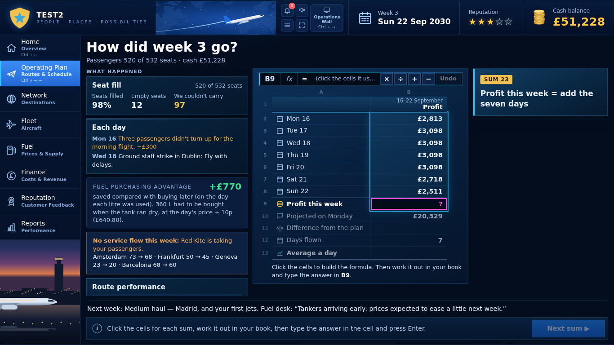

> "I like how at the start you have to do each one, add, each one, add. But then I think at this point it would be useful to do the SUM function, where you can drag across the range. Just another way to link ICT in, and also an easier way to do it. So we'll probably need one of those callouts, to show this new skill. Also, I'm not expecting them to add up that many numbers. So can you remove the calculation needed for profit this week? Just have it as they create the SUM. Same with the average a day: I wouldn't expect them to calculate that at this stage."

(The transcript heard "Just have it as they create some"; "create the SUM" is my reading.)

**What it does now:** Sum 23 builds "= B2 + B3 + … + B8" by clicking the seven day cells, then the pupil adds them in their book and types the total. Difference from the plan and Average a day follow the same way.

**For the design:**

- From week 3: drag across B2:B8 to make =SUM(B2:B8), with a callout the first time. The sheet fills in the total once the formula is right.
- Average a day: the pupil builds the formula and the sheet works it out, with no sum in the book.
- Both run against DESIGN.md as it stands (next section).

### 11. Home and New today, week 4 (15:49–16:59)

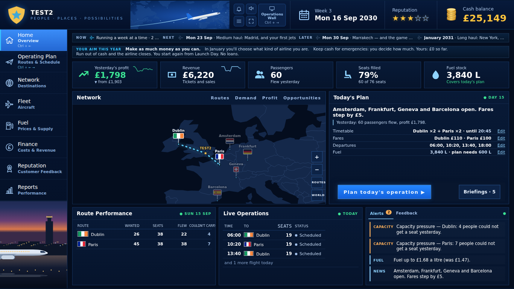

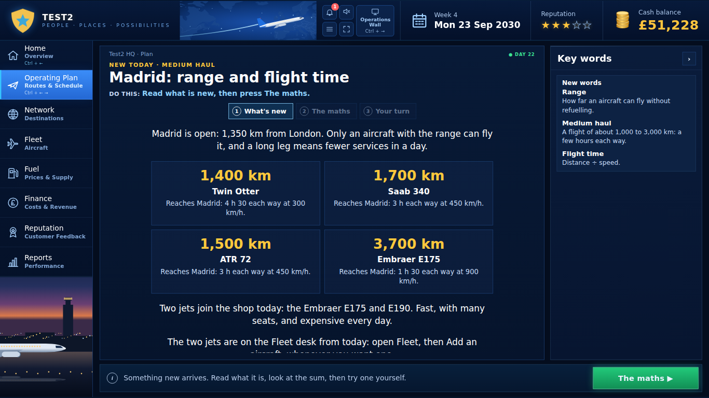

> "When did the new routes come in? Did I miss it? It's now week four. Do they appear in week three, and I just didn't notice? … On the last review, it mentioned Red Kite taking some of my passengers, but places like Frankfurt — I don't think I had the opportunity for that. If I didn't have the opportunity, the review should not mention them."

Answered from the save in the next section.

## Bertie's two questions, answered from the saves

**Did week 2 give a chance to change the flights? Yes, on Monday 9 Sep, before the recording began.** The save's steps for that day were Home, Plan, Sums, Fuel desk, Ready, Fly and Results, and the recording starts at the Fuel desk. The plan went on unchanged: Dublin at £110, Paris at £100, the same four flights. Once the week starts it runs straight through, so the school trip on Tuesday is a decision card, not a chance to re-plan. In week 3 Bertie did change the plan: Dublin went to £100.

**When did the new routes open? Monday 16 Sep, the start of week 3.** Amsterdam, Frankfurt, Geneva and Barcelona were mentioned four times before or on that day, but never on the plan screens:

| Where | What it said |
| --- | --- |
| Fuel desk, week 2 (signal) | "Four new destinations and a second aircraft." |
| Sunday review, week 2 (footer) | "Next week: New routes — Amsterdam, Frankfurt, Geneva, Barcelona." |
| Home, week 3 (Today's Plan) | "Amsterdam, Frankfurt, Geneva and Barcelona open. Fares step by £5." |
| Flight times, week 3 | Lists all four routes and their times |
| Plan opener, week 3 | Nothing: its This week list has fuel and Dublin's fare only |
| Studio, week 3 | "2 routes" and an Add / change routes button, with nothing pointing to it |

So Bertie could have flown them, but the place where a pupil plans never said so. The week 3 review then said "No service flew this week: Red Kite is taking your passengers. Amsterdam 73 → 68 · Frankfurt 50 → 45 · Geneva 23 → 20 · Barcelona 68 → 60", which reads as blame for routes the pupil didn't knowingly have.

**For the design:** in the week the routes open, put them at the top of the plan opener's This week list, with "Add a route ›", and light Add / change routes in the Studio with a first-time callout. The review should only name an unflown route once the pupil has been shown it, and then as a chance ("You could fly these: Red Kite flies them now") rather than a loss.

## Where the asks run against DESIGN.md

Two asks need DESIGN.md to change before they are built, and one adds a rule it doesn't have yet.

| Ask | DESIGN.md now | What would change |
| --- | --- | --- |
| =SUM by dragging a range, from week 3 (screen 10) | Sheet: "Spreadsheet skills step up later (direction, not for year one): click cells → type the formula himself → =SUM and =AVERAGE → fill a formula along a row." | =SUM moves into year one, at the week 3 review |
| No hand calculation for the week's profit or the average a day (screen 10) | Review sums: "click the day cells into the formula bar … type the answer in the cell, Enter" | The pupil builds the formula and the sheet works out the answer, for these two sums from week 3. The workbook's review sums (D61: total, difference, mean) change to match |
| Dim the rest of the screen during a tour (screen 1) | Only a sum being worked dims the rest of its sheet (62%) | A new rule: a tour step dims everything but the panel it is on |

The other asks fit DESIGN.md as it stands: first-time callouts (Sheet Callout), words on graph axes, and the plan screens naming what is new this week.

## Proposed changes for the next round

Nothing below is built yet. Tick what should go in, and change any wording. Everything is year one only, gated on the game date as CLAUDE.md asks.

**From the 20 Oct answers**

- [ ] Launch Day: the first ticket sum (Paris at £80, B4) becomes a Build; the other columns stay Calculate.

**Fit DESIGN.md as it stands**

- [ ] Fuel desk tour: hold the order cell's caret until the tour reaches Place a purchase order.
- [ ] Fuel desk: a first-time callout on the tank's size (8,000 L, about two weeks of flying).
- [ ] Star rating: drop the What it is worth panel, or redraw it as two queues (3 stars and 3½).
- [ ] Flight times: mark the rows the game fills in as ƒ, muted.
- [ ] Week 3 plan opener and Studio: light the Sat–Sun switch with a first-time callout.
- [ ] Week 3 plan opener: the four new routes at the top of This week, with Add a route ›; light Add / change routes in the Studio.
- [ ] Week 3 review: name unflown routes as a chance, and only once the pupil has been shown them.
- [ ] Changes sheet: the first-time callout points at the Difference column and reads one row in words.
- [ ] Operations Wall graph: title after the tab, axis titles in words, "so far" on this week's bar, key at the top right.

**Need DESIGN.md to change first**

- [ ] Tours dim everything but the panel they are on.
- [ ] Week 3 review: =SUM by dragging B2:B8, with a first-time callout; the sheet fills in the total.
- [ ] From week 3: no hand calculation for the week's profit or the average a day.

**Waiting on the scene-by-scene doc**

- [ ] How long will it take?: why first, then the sum step by step, then the ruler as the check.
